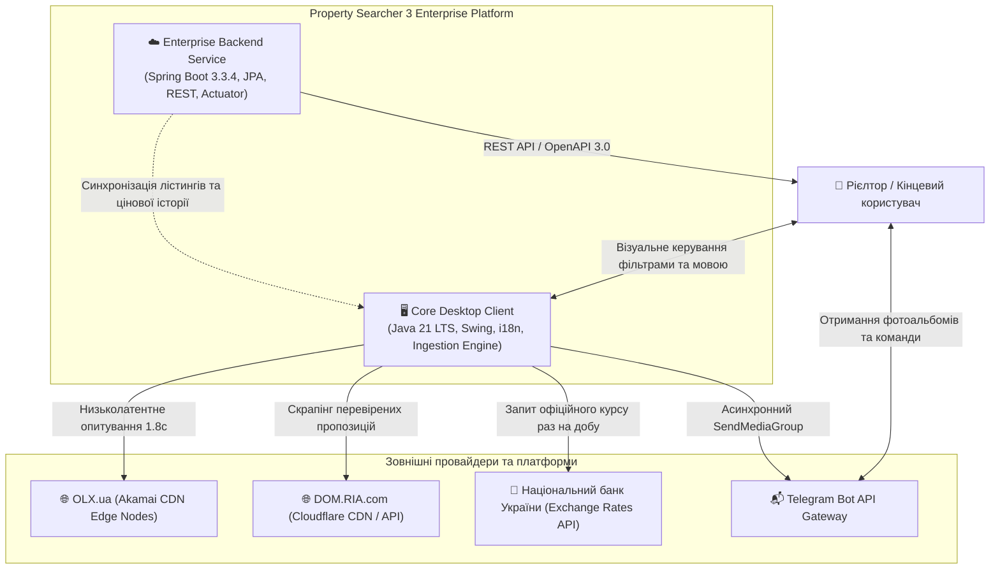
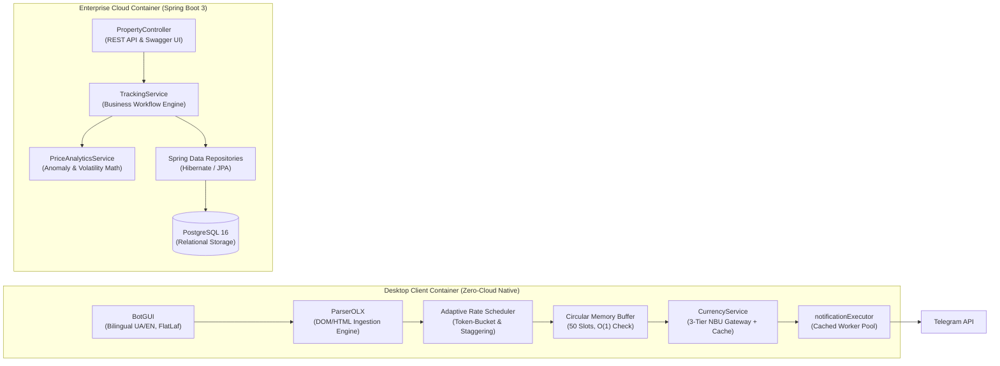
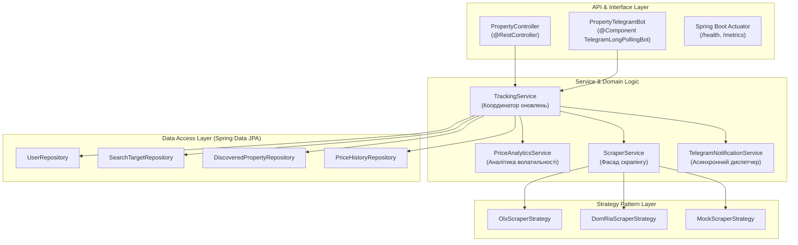
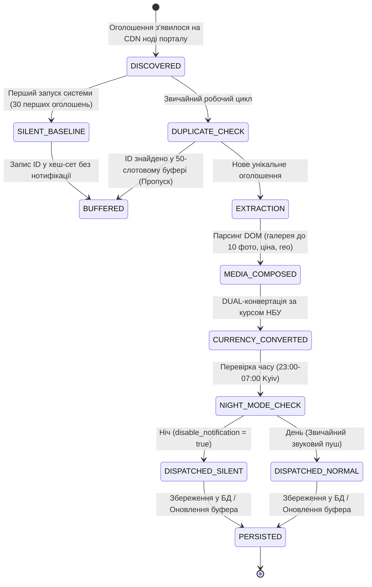
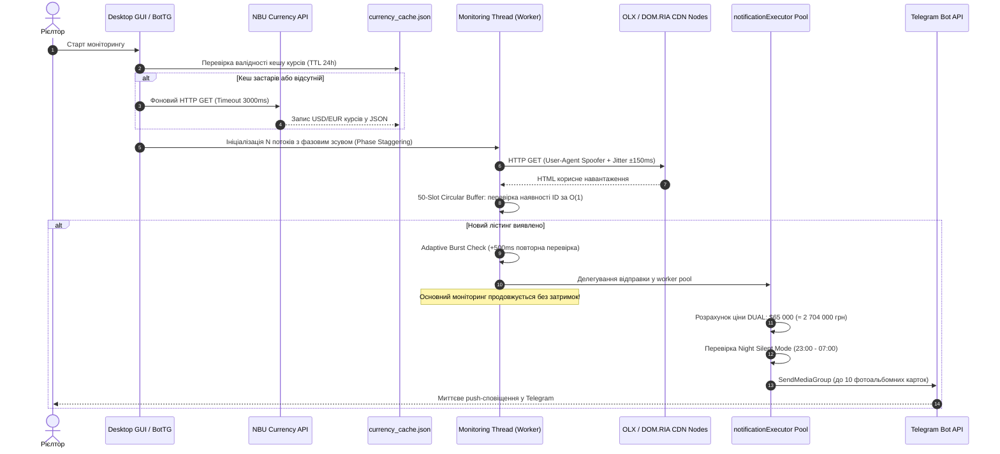

# Архітектура системи: Property Searcher 3 🏛️

> **Рівень документа:** Software Architecture Document (SAD)  
> **Методологія:** C4 Model (Context, Container, Component, Code) & Clean Architecture  
> **Головний архітектор:** `kvolegi`

---

## 1. C4 Контекстна діаграма системи (System Context)

---

## 2. C4 Діаграма контейнерів (Container Diagram)

---

## 3. C4 Діаграма компонентів бекенду (Backend Component Diagram)

---

## 4. Життєвий цикл лістингу (Listing State Machine)

---

## 5. Event-Driven Sequence Diagram (Діаграма послідовності)

---

## 6. Каталог використаних шаблонів проєктування (Design Patterns)

| Шаблон (GoF Pattern) | Клас / Компонент | Роль в системі |
| :--- | :--- | :--- |
| **Strategy** | `ScraperStrategy`, `OlxScraperStrategy` | Ізоляція алгоритмів парсингу для різних порталів |
| **Token-Bucket Rate Limiter** | `BotTG.calculateAdaptiveDelay()` | Запобігання блокуванням за IP та WAF CloudFront |
| **Circuit Breaker / Fallback** | `CurrencyService` | 3-рівневий шлюз валют (NBU API $\to$ Local Cache $\to$ Built-in Constants) |
| **Circular Buffer (FIFO)** | Внутрішній масив 50 слотів у `BotTG` | Робота зі стабільною пам'яттю $O(1)$ без витоків |
| **Worker Pool (Producer-Consumer)**| `Executors.newCachedThreadPool()` | Асинхронне надсилання важких альбомів без зупинки парсингу |
| **Observer** | Telegram API `onUpdateReceived()` | Реактивна обробка команд користувачів (`/language`, `/currency`) |
| **Singleton** | `SettingsManager` | Гарантія єдиного джерела конфігурації в системі |
