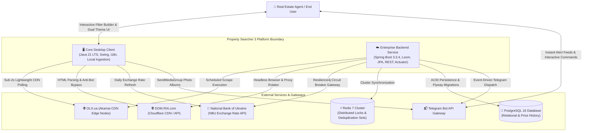
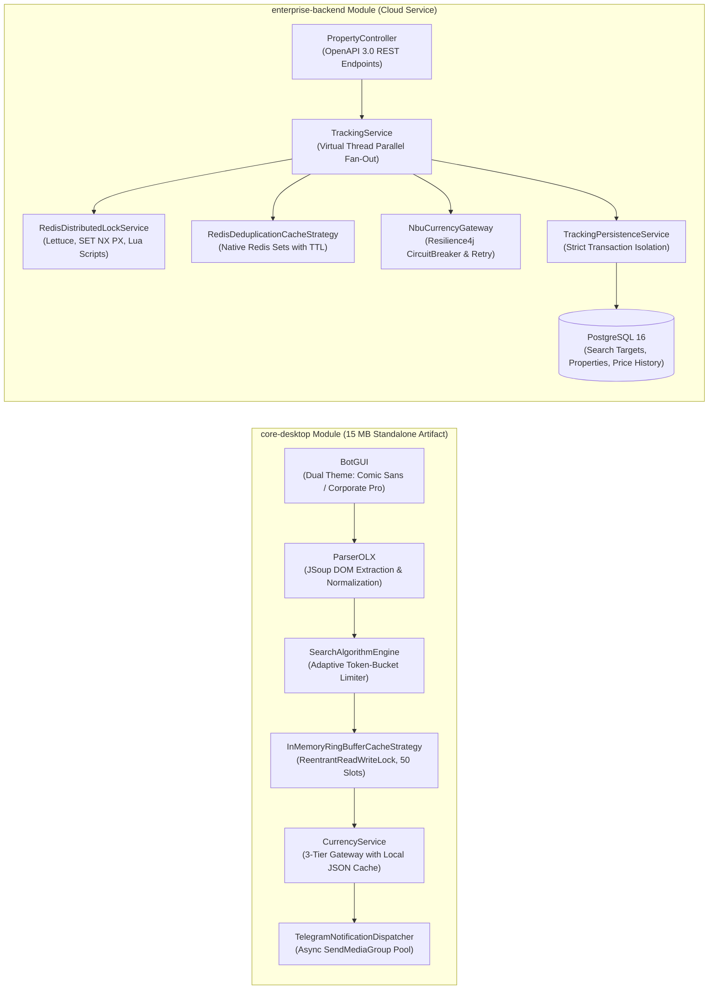
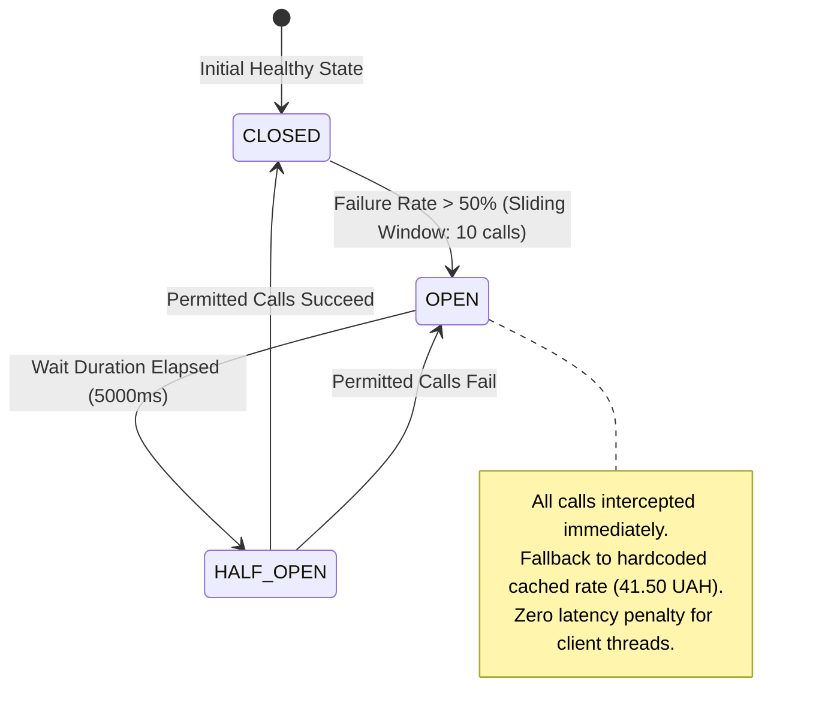

# Software Architecture Document (SAD): Property Searcher 3 🏛️

> **Standard:** ISO/IEC/IEEE 42010 Architecture Description & C4 Model  
> **Status:** Production / Release v3.1.0  
> **System Class:** High-Throughput Real Estate Ingestion & Distributed Valuation Platform  
> **Author & Lead Architect:** `@kvolegi`

---

## 1. Executive Architectural Summary

**Property Searcher 3** is a distributed real estate ingestion, valuation, and alerting platform tailored for high-velocity secondary property markets (OLX.ua and DOM.RIA.com). The system detects fresh property listings within **~1.8 seconds** of public availability, normalizes multi-currency pricing using official National Bank of Ukraine (NBU) exchange rates, evaluates dynamic bargain scores, and dispatches rich photo galleries to Telegram subscribers.

The platform is designed around two decoupled runtime tiers:
1. **Core Desktop Client (`core-desktop`)**: A zero-cloud, footprint-optimized client (15 MB JAR) built on Java 21 LTS and FlatLaf Swing, featuring dual theme switching (Comic Sans MS default vs Corporate Pro Segoe UI), bilingual localization, and an in-memory $O(1)$ ring buffer.
2. **Enterprise Cloud Backend (`enterprise-backend`)**: A cloud-native microservice built on **Spring Boot 3.3.4** and **Java 21 LTS**, powered by Project Loom virtual threads, Redis 7 cluster state synchronization, PostgreSQL 16 persistence, Flyway migrations, Resilience4j fault barriers, and production Kubernetes/Helm deployment manifests.

---

## 2. C4 Level 1: System Context Diagram



---

## 3. C4 Level 2: Container Diagram (Multi-Module Architecture)

The Maven reactor is decoupled into isolated submodules to preserve bounded contexts:



---

## 4. Concurrency Architecture: Java 21 Project Loom & Parallel Fan-Out

### 4.1. The Thread Starvation Challenge
Traditional web scraping services use blocking I/O (HTTP requests to external portals typically take between 200 ms and 2500 ms). Operating-system-bound thread pools (`ThreadPoolExecutor`) quickly exhaust carrier threads under concurrent workloads, leading to thread starvation, high memory overhead (~1 MB stack per OS thread), and latency spikes.

### 4.2. Virtual Thread Parallel Fan-Out
`enterprise-backend` configures Java 21 Project Loom via `AsyncConcurrencyConfig.java`:
```java
@Bean(name = "virtualThreadExecutor")
public ExecutorService virtualThreadExecutor() {
    return Executors.newVirtualThreadPerTaskExecutor();
}
```

In `TrackingService.java`, active target polling executes via non-blocking parallel fan-out:
```java
List<SearchTarget> targets = searchTargetRepository.findAllByActiveTrue();

if (virtualThreadExecutor != null && !targets.isEmpty()) {
    List<CompletableFuture<Void>> futures = targets.stream()
            .map(target -> CompletableFuture.runAsync(() -> {
                try {
                    processTarget(target);
                } catch (Exception e) {
                    log.error("Error processing target [{}] on Loom: {}", target.getTitle(), e.getMessage());
                }
            }, virtualThreadExecutor))
            .toList();

    CompletableFuture.allOf(futures.toArray(new CompletableFuture[0])).join();
}
```
* **Performance Impact:** Every external portal query executes within its own lightweight virtual thread (~1 KB initial footprint). Carrier OS threads are unmounted during socket I/O wait times, allowing hundreds of concurrent search rules to execute simultaneously without thread starvation.

---

## 5. Distributed Systems: Redis 7 Cluster State & Atomic Lua Scripts

To support horizontal scaling across multiple pods in Kubernetes, distributed state synchronization is managed via `spring-boot-starter-data-redis` (Lettuce):

### 5.1. Atomic Mutual Exclusion (`SET NX PX`)
Distributed execution locks for scheduled cycles are acquired atomically:
```java
Boolean acquired = redisTemplate.opsForValue()
        .setIfAbsent(lockKey, token, leaseDuration);
```

### 5.2. Atomic Lock Release with Canonical Lua Script
Releasing a lock requires verifying ownership to avoid releasing another node's lock if the local lease expired during a slow network call. This is executed atomically on the Redis server:
```lua
if redis.call('get', KEYS[1]) == ARGV[1] then
    return redis.call('del', KEYS[1])
else
    return 0
end
```
Executed via `RedisScript<Long>` with Spring's `StringRedisTemplate`.

### 5.3. Cluster-Wide Deduplication with Redis Sets & TTL
`RedisDeduplicationCacheStrategy.java` stores discovered listing IDs in native Redis Sets:
- `SISMEMBER dedup:<targetKey> <listingUrl>` provides $O(1)$ containment checks.
- `SADD dedup:<targetKey> <listingUrl>` registers new items.
- Key TTL expiration (`expire(key, Duration.ofHours(ttlHours))`) automatically purges stale history, guaranteeing memory hygiene.

---

## 6. Fault Tolerance: Resilience4j Circuit Breaker & Fallback Architecture

External API dependencies (e.g. National Bank of Ukraine exchange rates) are guarded using **Resilience4j Circuit Breaker & Retry**:



* **Retry Policy:** 3 attempts with exponential backoff (`initialInterval = 1000ms`, `multiplier = 2`).
* **Fallback Degradation:** When upstream NBU returns HTTP 500 or network timeouts occur, the fallback method smoothly provides the cached rate without propagating exceptions or halting the application.

---

## 7. Database Hygiene & Transaction Isolation

A critical design flaw in junior scrapers is placing network calls inside `@Transactional` methods, holding database connections from HikariCP during slow HTTP operations.

`Property-Searcher` enforces strict transactional separation:
1. `TrackingService.processTarget()` runs **outside any database transaction**. Network I/O and HTML parsing complete entirely in memory.
2. Only after parsing succeeds, the extracted `PropertyDto` objects are handed to `TrackingPersistenceService.java`:
```java
@Transactional
public void persistDatabaseAnalytics(SearchTarget target, List<PropertyDto> scraped, ...) {
    // Short-lived, high-speed database write transaction
    // Releases HikariCP connection in < 15 milliseconds
}
```

---

## 8. Cloud-Native Deployment & Kubernetes Stack

The platform includes production-grade container orchestration manifests:

```
k8s/
├── namespace.yaml          # Isolated "property-searcher" namespace
├── configmap.yaml          # Environment settings & active profiles
├── secret.yaml             # Encrypted DB credentials & Telegram Bot tokens
├── deployment.yaml        # RollingUpdate strategy, 2 replicas, probes, securityContext
├── service.yaml           # ClusterIP routing internal traffic on port 8080
├── hpa.yaml               # HorizontalPodAutoscaler scaling from 2 to 10 pods
└── ingress.yaml           # NGINX Ingress Controller with TLS termination
```

* **Helm 3 Chart (`helm/property-searcher/`)**: Parameterized deployment chart with templated `values.yaml`, resource bounds (`requests: 250m / 512Mi`, `limits: 1000m / 1024Mi`), and `PodAntiAffinity` rules for multi-zone resilience.

---

## 9. Comprehensive Verification & Testing Matrix

The platform is validated by **74 automated unit, integration, and socket tests** across all layers:

| Layer | Technology | Key Scenarios Verified |
| :--- | :--- | :--- |
| **Circuit Breakers** | WireMock + Spring Context | Real HTTP socket failure injection, trip points, fallback rates. |
| **Distributed Locks** | Mockito + Lettuce Redis | Atomic `SET NX PX`, ownership token validation, Lua script execution. |
| **Deduplication Cache** | JUnit 5 + Redis Sets | $O(1)$ set containment, TTL assignment, cluster memory bounds. |
| **Virtual Threads** | Project Loom Concurrency | Multi-target parallel fan-out, non-blocking execution. |
| **REST API** | Spring WebMvc MockMvc | Pagination, RFC 7807 problem details, parameter validation. |
| **Persistence** | Testcontainers + Flyway | PostgreSQL 16 schema creation, composite index verification. |
| **Rate Limiter** | Pure Java Core | Token-bucket adaptive delays ($\tau = \max(1800\text{ms}, N \times 1000 / 2.2)$). |

---

## 10. Conclusion

Property Searcher 3 demonstrates production-grade software engineering principles: strict modular encapsulation, non-blocking virtual thread concurrency, resilient distributed synchronization, and enterprise cloud readiness.
