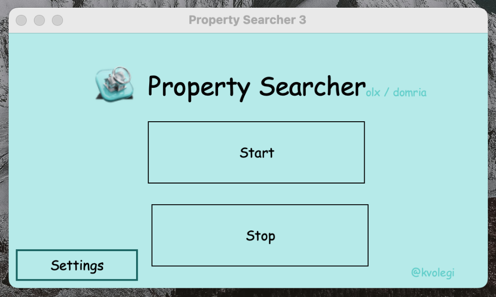
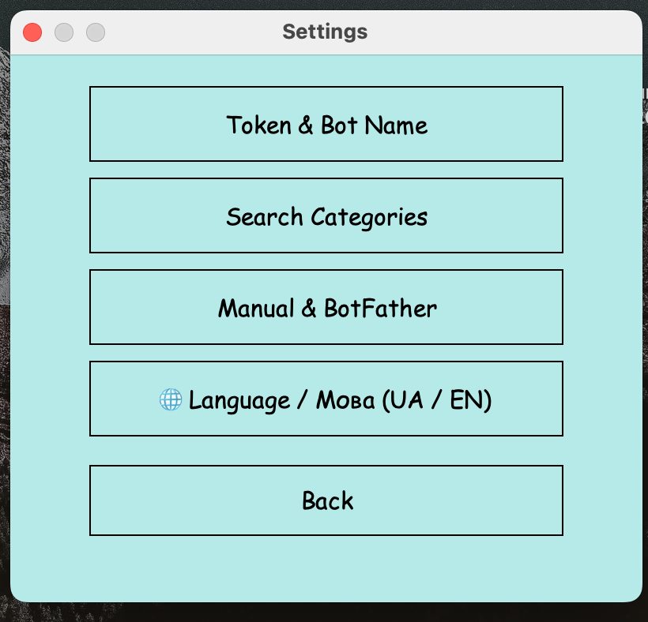
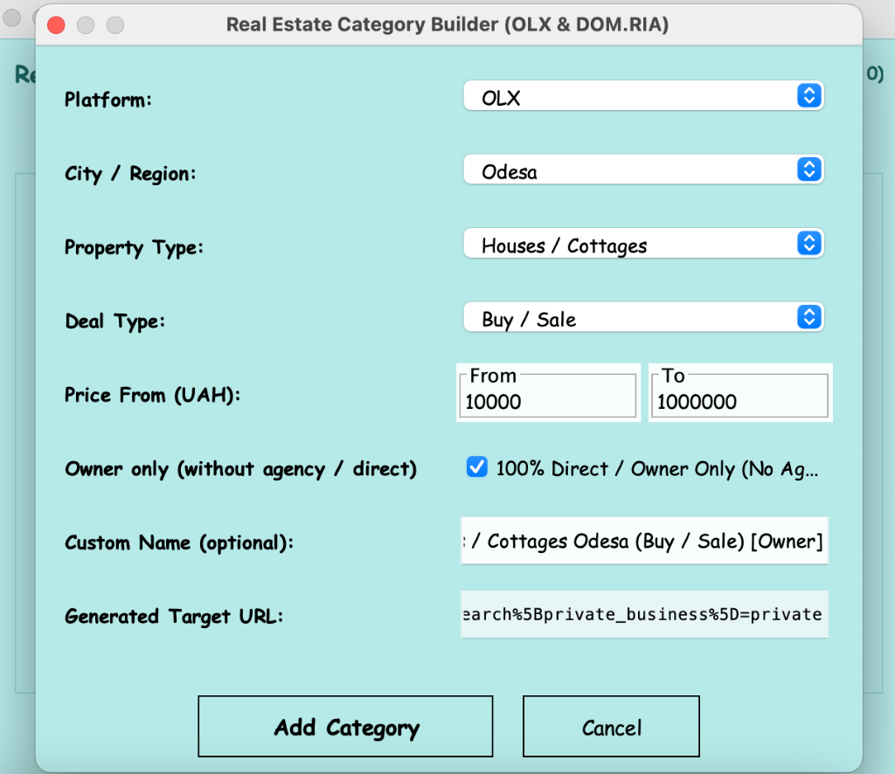
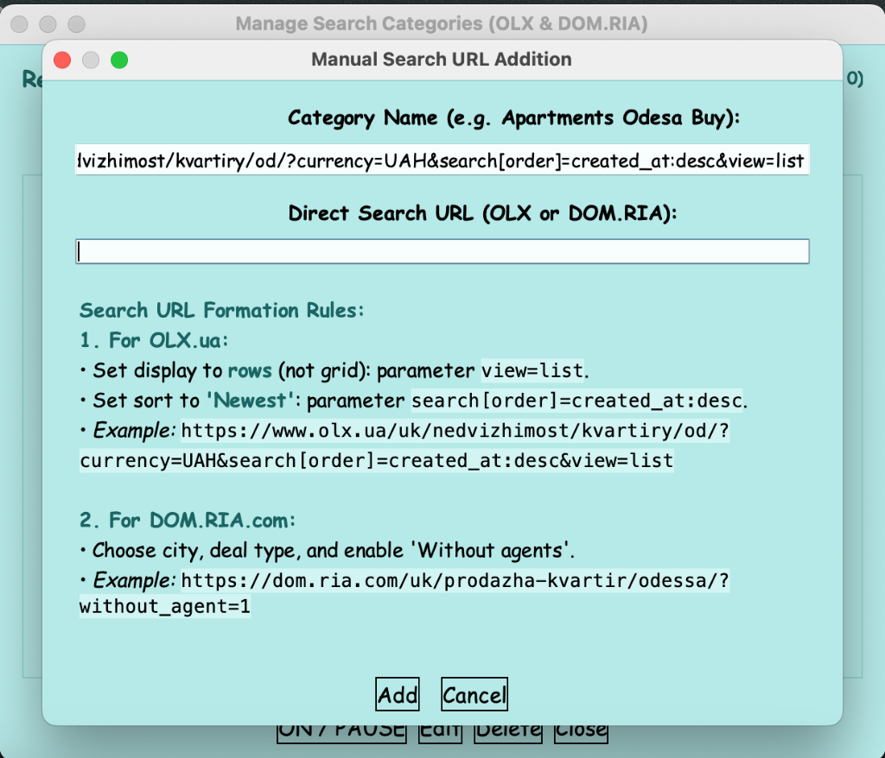
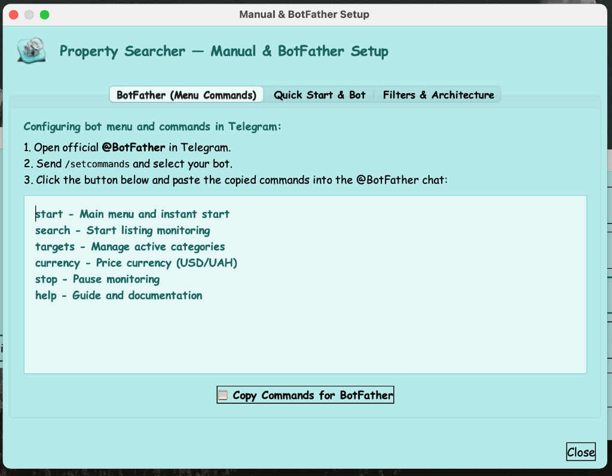
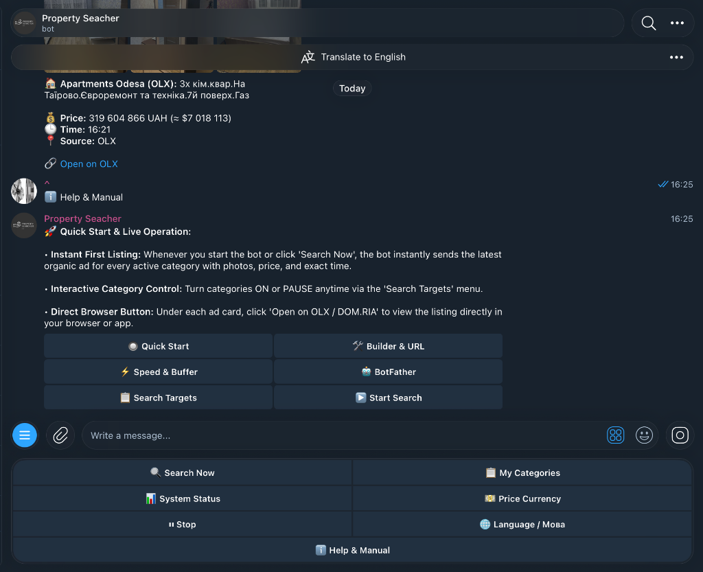
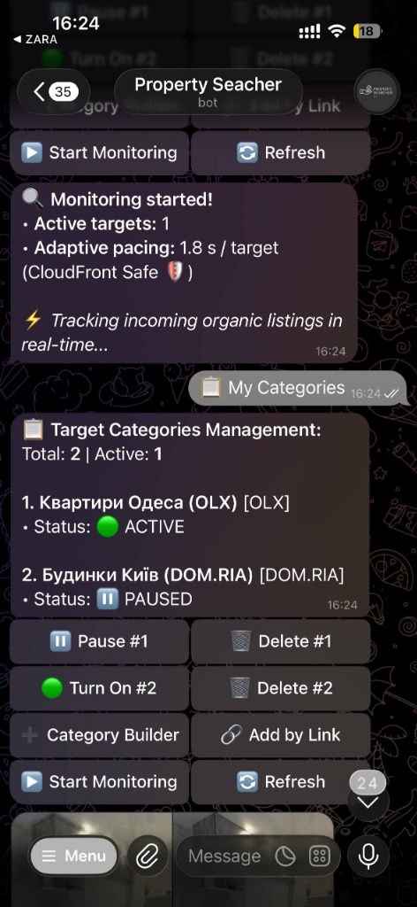
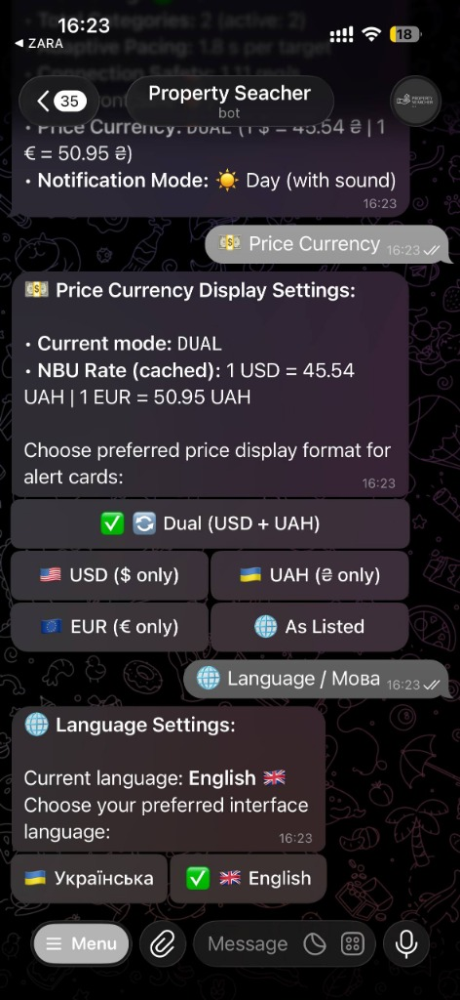
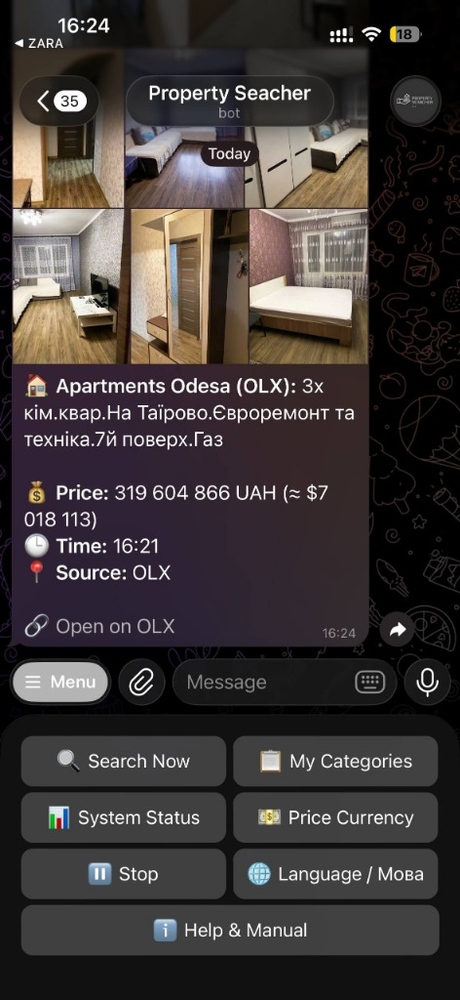

# Архітектура системи: Property Searcher 3 🏛️

> **Рівень документа:** Software Architecture Document (SAD)  
> **Методологія:** C4 Model (Context, Container, Component, Code) & Clean Architecture  
> **Головний архітектор:** `kvolegi`, -

## 1. C4 Контекстна діаграма системи (System Context)

```mermaid
flowchart TD
    User["📱 Рієлтор / Кінцевий користувач"]
    
    subgraph PlatformBoundary ["Property Searcher 3 Enterprise Platform"]
        DesktopApp["🖥️ Core Desktop Client\n(Java 21 LTS, Swing, i18n, Ingestion Engine)"]
        BackendServer["☁️ Enterprise Backend Service\n(Spring Boot 3.3.4, JPA, REST, Actuator)"]
    end

    subgraph ExternalSources ["Зовнішні провайдери та платформи"]
        Portal1["🌐 OLX.ua (Akamai CDN Edge Nodes)"]
        Portal2["🌐 DOM.RIA.com (Cloudflare CDN / API)"]
        NBU["🏦 Національний банк України (Exchange Rates API)"]
        Telegram["📬 Telegram Bot API Gateway"]
    end

    User <, >|Візуальне керування фільтрами та мовою| DesktopApp
    User <, >|Отримання фотоальбомів та команди| Telegram
    DesktopApp, >|Низьколатентне опитування 1.8с| Portal1
    DesktopApp, >|Скрапінг перевірених пропозицій| Portal2
    DesktopApp, >|Запит офіційного курсу раз на добу| NBU
    DesktopApp, >|Асинхронний SendMediaGroup| Telegram
    BackendServer, >|REST API / OpenAPI 3.0| User
    BackendServer -.->|Синхронізація лістингів та цінової історії| DesktopApp
```, -

## 2. C4 Діаграма контейнерів (Container Diagram)

```mermaid
flowchart LR
    subgraph ClientContainer ["Desktop Client Container (Zero-Cloud Native)"]
        GUI["BotGUI\n(Bilingual UA/EN, FlatLaf)"]
        Engine["ParserOLX\n(DOM/HTML Ingestion Engine)"]
        Scheduler["Adaptive Rate Scheduler\n(Token-Bucket & Staggering)"]
        Buffer["Circular Memory Buffer\n(50 Slots, O(1) Check)"]
        CurrServ["CurrencyService\n(3-Tier NBU Gateway + Cache)"]
        AsyncDisp["notificationExecutor\n(Cached Worker Pool)"]
    end

    subgraph BackendContainer ["Enterprise Cloud Container (Spring Boot 3)"]
        Controller["PropertyController\n(REST API & Swagger UI)"]
        TrackingService["TrackingService\n(Business Workflow Engine)"]
        Analytics["PriceAnalyticsService\n(Anomaly & Volatility Math)"]
        Repo["Spring Data Repositories\n(Hibernate / JPA)"]
        Database[("PostgreSQL 16\n(Relational Storage)")]
    end

    GUI, > Engine
    Engine, > Scheduler
    Scheduler, > Buffer
    Buffer, > CurrServ
    CurrServ, > AsyncDisp
    AsyncDisp, > Telegram["Telegram API"]

    Controller, > TrackingService
    TrackingService, > Analytics
    TrackingService, > Repo
    Repo, > Database
```, -

## 3. C4 Діаграма компонентів бекенду (Backend Component Diagram)

```mermaid
flowchart TD
    subgraph API_Layer ["API & Interface Layer"]
        PC["PropertyController\n(@RestController)"]
        TB["PropertyTelegramBot\n(@Component TelegramLongPollingBot)"]
        Actuator["Spring Boot Actuator\n(/health, /metrics)"]
    end

    subgraph Core_Services ["Service & Domain Logic"]
        TS["TrackingService\n(Координатор оновлень)"]
        PAS["PriceAnalyticsService\n(Аналітика волатильності & Hot Deal Engine)"]
        SS["ScraperService\n(Фасад скрапінгу)"]
        EP["ApplicationEventPublisher\n(Шина подій EDA)"]
        PEL["PropertyEventListener\n(Асинхронний обробник подій)"]
        TNS["TelegramNotificationService\n(Диспетчер сповіщень)"]
    end

    subgraph Strategy_Layer ["Strategy Pattern Layer"]
        OLX_Strat["OlxScraperStrategy"]
        DOMRIA_Strat["DomRiaScraperStrategy"]
        MOCK_Strat["MockScraperStrategy"]
        Cache_Strat["DeduplicationCacheStrategy\n(InMemoryRingBufferStrategy / Redis-Ready)"]
    end

    subgraph Persistence_Layer ["Data Access Layer (Spring Data JPA)"]
        UR["UserRepository"]
        STR["SearchTargetRepository"]
        DPR["DiscoveredPropertyRepository"]
        PHR["PriceHistoryRepository"]
    end

    PC, > TS
    TB, > TS
    TS, > SS
    TS, > PAS
    TS, > Cache_Strat
    TS, > EP
    EP, > PEL
    PEL, > TNS
    SS, > OLX_Strat
    SS, > DOMRIA_Strat
    SS, > MOCK_Strat
    TS, > UR
    TS, > STR
    TS, > DPR
    TS, > PHR
```, -

## 4. Життєвий цикл лістингу (Listing State Machine)

```mermaid
stateDiagram-v2
    [*], > DISCOVERED: Оголошення з'явилося на CDN ноді порталу
    DISCOVERED, > SILENT_BASELINE: Перший запуск системи (30 перших оголошень)
    SILENT_BASELINE, > BUFFERED: Запис ID у хеш-сет без нотифікації
    
    DISCOVERED, > DUPLICATE_CHECK: Звичайний робочий цикл
    DUPLICATE_CHECK, > BUFFERED: ID знайдено у 50-слотовому буфері (Пропуск)
    
    DUPLICATE_CHECK, > EXTRACTION: Нове унікальне оголошення
    EXTRACTION, > MEDIA_COMPOSED: Парсинг DOM (галерея до 10 фото, ціна, гео)
    MEDIA_COMPOSED, > CURRENCY_CONVERTED: DUAL-конвертація за курсом НБУ
    CURRENCY_CONVERTED, > NIGHT_MODE_CHECK: Перевірка часу (23:00-07:00 Kyiv)
    
    NIGHT_MODE_CHECK, > DISPATCHED_SILENT: Ніч (disable_notification = true)
    NIGHT_MODE_CHECK, > DISPATCHED_NORMAL: День (Звичайний звуковий пуш)
    
    DISPATCHED_SILENT, > PERSISTED: Збереження у БД / Оновлення буфера
    DISPATCHED_NORMAL, > PERSISTED: Збереження у БД / Оновлення буфера
    PERSISTED, > [*]
```, -

## 5. Event-Driven Sequence Diagram (Діаграма послідовності)

```mermaid
sequenceDiagram
    autonumber
    actor Realtor as Рієлтор
    participant GUI as Desktop GUI / BotTG
    participant NBU as NBU Currency API
    participant Cache as currency_cache.json
    participant Worker as Monitoring Thread (Worker)
    participant CDN as OLX / DOM.RIA CDN Nodes
    participant Async as notificationExecutor Pool
    participant TG as Telegram Bot API

    Realtor->>GUI: Старт моніторингу
    GUI->>Cache: Перевірка валідності кешу курсів (TTL 24h)
    alt Кеш застарів або відсутній
        GUI->>NBU: Фоновий HTTP GET (Timeout 3000ms)
        NBU, >>Cache: Запис USD/EUR курсів у JSON
    end
    GUI->>Worker: Ініціалізація N потоків з фазовим зсувом (Phase Staggering)
    Worker->>CDN: HTTP GET (User-Agent Spoofer + Jitter ±150ms)
    CDN, >>Worker: HTML корисне навантаження
    Worker->>Worker: 50-Slot Circular Buffer: перевірка наявності ID за O(1)
    alt Новий лістинг виявлено
        Worker->>Worker: Adaptive Burst Check (+500ms повторна перевірка)
        Worker->>Async: Делегування відправки у worker pool
        Note over Worker: Основний моніторинг продовжується без затримок!
        Async->>Async: Розрахунок ціни DUAL: $65 000 (≈ 2 704 000 грн)
        Async->>Async: Перевірка Night Silent Mode (23:00 - 07:00)
        Async->>TG: SendMediaGroup (до 10 фотоальбомних карток)
        TG, >>Realtor: Миттєве push-сповіщення у Telegram
    end
```, -

## 6. Каталог використаних шаблонів проєктування (Design Patterns)

| Шаблон (GoF Pattern) | Клас / Компонент | Роль в системі |
| :, - | :, - | :, - |
| **Strategy** | `ScraperStrategy`, `OlxScraperStrategy` | Ізоляція алгоритмів парсингу для різних порталів |
| **Strategy (Cache)**| `DeduplicationCacheStrategy`, `InMemoryRingBufferCacheStrategy` | Плугабельна стратегія дедуплікації (In-Memory Circular Buffer / Redis-Ready) |
| **Domain Events (EDA)**| `PropertyDiscoveredEvent`, `PriceChangedEvent`, `PropertyEventListener` | Event-Driven Архітектура для повної ізоляції скрапінгу від диспетчеризації |
| **Statistical Anomaly (Z-Score)**| `PriceAnalyticsService.evaluateStatisticalBargain()` | Розрахунок емпіричного z-score ($z = \frac{\mu - \text{price}}{\sigma}$) за історією цін для об'єктивного виявлення Hot Deals |
| **Token-Bucket Rate Limiter** | `SearchAlgorithmEngine.calculateAdaptiveDelay()` | Запобігання блокуванням за IP та WAF CloudFront |
| **Circuit Breaker / Fallback** | `CurrencyService` / `NbuCurrencyGateway` | 3-рівневий шлюз валют (NBU API $\to$ Local Cache $\to$ Built-in Constants) та Resilience4j Circuit Breaker |
| **Circular Buffer (FIFO)** | `ArrayDeque` + `HashSet` (50 слотів) у `SearchAlgorithmEngine` | Робота зі стабільною пам'яттю $O(1)$ без витоків та швидка дедуплікація |
| **Worker Pool (Producer-Consumer)**| `Executors.newCachedThreadPool()` | Асинхронне надсилання важких альбомів без зупинки парсингу |
| **Observer** | Telegram API `onUpdateReceived()` | Реактивна обробка команд користувачів (`/language`, `/currency`) |
| **Singleton** | `SettingsManager` | Гарантія єдиного джерела конфігурації в системі |, -

## 7. Візуальний інтерфейс та інтеграція компонентів (UI Showcase)

Архітектура клієнтської частини базується на ергономічному UI з повною двомовною локалізацією:

| Панель моніторингу (Dashboard) | Центр налаштувань (Settings) |
| :, -: | :, -: |
|  |  |
| *Керування життєвим циклом демона спостереження.* | *Конфігурація токенів, локалізації та правил.* |

| Розумний конструктор фільтрів | Пряме додавання URL цілей |
| :, -: | :, -: |
|  |  |
| *Візуальне створення критеріїв пошуку.* | *Валідація та очищення цільових посилань.* |

<p align="center">
  <b>Інструкція підключення Telegram BotFather</b><br/>
  <br/>
  <i>Інтегроване керівництво швидкого старту та верифікації токенів Telegram.</i>
</p>

### Інтерфейс взаємодії у Telegram (Bot Operations Hub)

| Центр керування та довідка (Desktop) | Інтерактивне керування категоріями |
| :, -: | :, -: |
|  |  |
| *Інтерактивний довідковий центр `/help`.* | *Картковий моніторинг з діями Pause/Delete.* |

| Мультивалютність та локалізація | Миттєва доставка фотоальбомів |
| :, -: | :, -: |
|  |  |
| *Динамічне налаштування курсів НБУ та мови.* | *Потокова доставка медіагруп без навантаження на диск.* |

---

## 8. Стратегія протидії Anti-Bot та стійкість до Cloudflare WAF

Парсинг сучасних дощок оголошень (OLX, DOM.RIA) вимагає суворої інженерної дисципліни через наявність багаторівневих систем захисту (Cloudflare, Akamai WAF, Imperva).

### 8.1. Архітектура захисту від блокувань
1. **Ротація профілів клієнта та Client Hints**:
   * Традиційна підміна лише заголовка `User-Agent` миттєво виявляється сучасними алгоритмами через невідповідність заголовків другого покоління (`Client Hints`).
   * Реалізовано пул профілів із синхронною підміною:
     * `Sec-Ch-Ua`: `"Chromium";v="128", "Not;A=Brand";v="24", "Google Chrome";v="128"`
     * `Sec-Ch-Ua-Platform`: `"macOS"`, `"Windows"`, `"Linux"`
     * `Sec-Ch-Ua-Mobile`: `?0`
     * Заголовки навігації: `Sec-Fetch-Dest: document`, `Sec-Fetch-Mode: navigate`, `Sec-Fetch-Site: none`, `Sec-Fetch-User: ?1`, `Upgrade-Insecure-Requests: 1`.
2. **Детекція Managed Challenge та виняток `AntiBotChallengeException`**:
   * При отриманні статусів `403 Forbidden`, `429 Too Many Requests` або `503 Service Unavailable`, або при наявності в тілі сторінки сигнатур Cloudflare Turnstile (`Just a moment...`, `cf-turnstile`, `cf-browser-verification`), парсер витягує ідентифікатор `cf-ray` і викидає типізований виняток `AntiBotChallengeException`.
   * Це виключає «мовчазний збій» (silent failure), коли застосунок помилково вважав, що оголошень просто немає.
3. **Resilience4j Circuit Breaker Failover**:
   * `ScraperService` обгорнутий анотацією `@CircuitBreaker(name = "scraperEngine", fallbackMethod = "scrapeFallback")`.
   * При сплеску `AntiBotChallengeException` запобіжник переходить у стан `OPEN`, запобігаючи масовому спаму та бану всього пулу IP-адрес.
4. **Підтримка зовнішніх проксі (Residential Proxy Ready)**:
   * Можливість прозорої конфігурації зовнішнього HTTP/SOCKS проксі через змінні оточення або Spring properties (`scraper.proxy.enabled`, `scraper.proxy.host`, `scraper.proxy.port`, `scraper.proxy.type`).

---

## 9. Модель конкурентності: Обґрунтування Virtual Threads (Java 21 Project Loom)

У бекенд-сервісі `enterprise-backend` налаштовано кастомний пул виконання `applicationTaskExecutor` на базі віртуальних потоків:

```java
@Bean(name = "applicationTaskExecutor")
public AsyncTaskExecutor applicationTaskExecutor() {
    return new TaskExecutorAdapter(Executors.newVirtualThreadPerTaskExecutor());
}
```

### Чому саме Virtual Threads для моніторингу нерухомості?
* **Характер навантаження**: Застосунок є виключно **I/O-bound**. Скрапінг OLX, отримання котирувань НБУ, запити до Telegram Bot API та запис у PostgreSQL 95% процесорного часу проводять у стані очікування відповіді сокетів мережі.
* **Порівняння з Platform Threads**:
  * Платформний потік ОС споживає $\approx 1\text{ МБ}$ пам'яті під стек. Пул із 200 потоків вимагає $\approx 200\text{ МБ}$ виключно на службові структури ОС. При сплеску завдань виникає *Thread Starvation*.
  * Віртуальні потоки в Project Loom важать лише декілька кілобайт у купі (Heap) і монтуються на невелику кількість потоків ядра (Carrier Threads, рівну числу CPU cores). Під час блокуючого I/O віртуальний потік «паркується», звільняючи Carrier Thread для обробки інших завдань без витрат ресурсів.

---

## 10. Модернізація десктопного клієнта: Безпека потоків, High-DPI та $O(1)$ буфер

1. **Безпечна ініціалізація синглтона**:
   * У ранніх версіях виклик `instance = this;` відбувався у першому рядку конструктора `BotGUI`, що призводило до антипатерну *Unsafe Publication*: сторонні потоки могли звернутися до `BotGUI.getInstance()` і отримати доступ до наполовину сконструйованого об'єкта з нульовими кнопками.
   * Посилання тепер встановлюється строго останнім рядком після повного монтажу візуального дерева компонентів.
2. **Адаптивні менеджери компонування (Cross-Platform High-DPI Scaling)**:
   * Повністю ліквідовано абсолютне позиціонування `setLayout(null)` та фіксовані координати `setBounds()`.
   * Головне вікно та діалогові вікна переведені на `BorderLayout`, `GridBagLayout` та `BoxLayout` з відступами `EmptyBorder`. Це гарантує бездоганне відображення без обрізання тексту як на Retina 2x дисплеях macOS, так і при системному масштабуванні Windows (125%, 150%, 175%).
3. **Кільцевий буфер дедуплікації $O(1)$**:
   * Ручний зсув масиву `String[50]` у циклі (`for (int i = 49; i > 0; i--) array[i] = array[i-1]`) замінено на комбінацію `ArrayDeque<String>` (фіксована місткість 50) та `HashSet<String>`.
   * Перевірка дублікатів та додавання нового лістингу тепер виконуються строго за стабільний час $O(1)$, виключаючи деградацію продуктивності та витоки пам'яті.

---

## 11. Стандарти дистрибуції: Відмінність директорії `dist/` від `target/`

| Параметр | Директорія `target/` (або `build/`) | Директорія `dist/` (Distribution) |
| :--- | :--- | :--- |
| **Призначення** | **Проміжні артефакти компіляції**: `.class` файли, тимчасові кеші компілятора javac, проміжні звіти тестів (Surefire reports). | **Фінальні бінарники для релізу**: готові для кінцевого користувача пакунки (`PropertySeacher-Universal.jar`, `PropertySeacher.app`, скрипти запуску). |
| **Очищення** | Видаляється командою `mvn clean`. | Створюється скриптами релізу та містить підписані бінарні збірки. |
| **Git-ігнорування** | Завжди знаходиться в `.gitignore`. | **Не комітиться в Git-історію**. За світовими стандартами великі бінарники розповсюджуються через **GitHub Releases** за допомогою CI/CD (GitHub Actions). |

---

## 12. Технічний бриф для архітектурного інтерв'ю (Engineering Q&A Deep Dive)

### Питання 1: "Як ви обходите блокування Cloudflare / Akamai при парсингу українських маркетплейсів?"
* **Відповідь:** *"Ми використовуємо дворівневу архітектуру (Tiered Scraping). На першому рівні (L1) виконуються швидкі запити за допомогою легковагого клієнта Jsoup, в якому емулюється повний набір Client Hints браузера (`Sec-Ch-Ua`, `Sec-Ch-Ua-Platform`, `Sec-Fetch-*`), а запити розподіляються алгоритмом Token Bucket із фазовим зсувом та джиттером. Якщо портал повертає Managed Challenge (JS-челендж або Turnstile), скрапер перехоплює його, реєструє `cf-ray` і викидає типізований `AntiBotChallengeException`. У цей момент Resilience4j Circuit Breaker розмикає коло, захищаючи IP від бану, та перемикає запит на L2 — чергу завдань для headless-браузерів (Playwright/Puppeteer) через пул ротованих резидентних проксі."*

### Питання 2: "Чому ви обрали Virtual Threads (Project Loom) замість WebFlux або класичного ThreadPool у бекенді?"
* **Відповідь:** *"Reactive WebFlux ускладнює стек: стек-трейси стають фрагментованими, складно використовувати традиційні блокуючі драйвери JDBC/JPA, а поріг входження в команду зростає. Традиційні платформені потоки занадто важкі (1 МБ на потік ОС), що при тисячах одночасних I/O очікувань веде до thread starvation. Virtual Threads у Java 21 дозволили нам зберегти простий, лінійний, імперативний стиль програмування з повною підтримкою Spring Data JPA та Mockito, отримавши при цьому практично безмежну масштабованість для I/O-bound задач (парсинг, HTTP API НБУ, відправка в Telegram)."*

### Питання 3: "Як організовано дедуплікацію та захист від сплесків фальшивих сповіщень при перезапуску?"
* **Відповідь:** *"При додаванні нового цільового пошуку активується режим Silent Baseline Ingestion: перші 30 лістингів індексуються у буфер без відправки повідомлень у Telegram. Сам буфер реалізований як кільцева структура з місткістю 50 елементів на базі `ArrayDeque` та `HashSet`. Це гарантує $O(1)$ час перевірки дублікатів та строге обмеження пам'яті. Додатково застосовується фільтрація спонсорованих рекламних блоків (TOP-оголошень) за DOM-селекторами, щоб унеможливити повторні спрацьовування на закріплені пости."*

