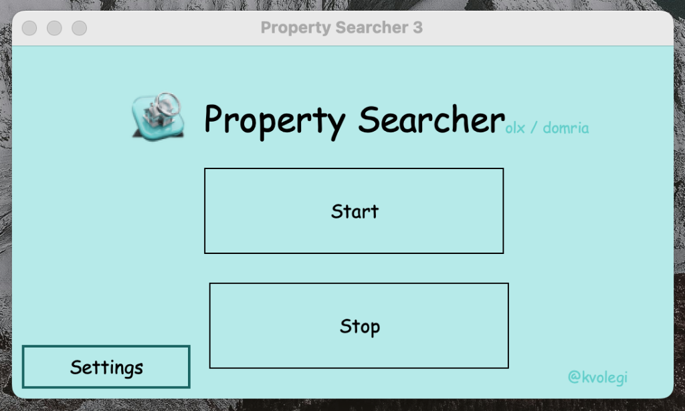
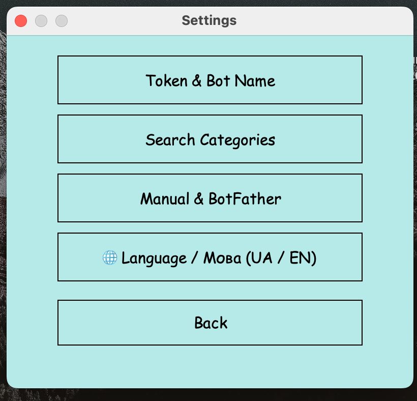
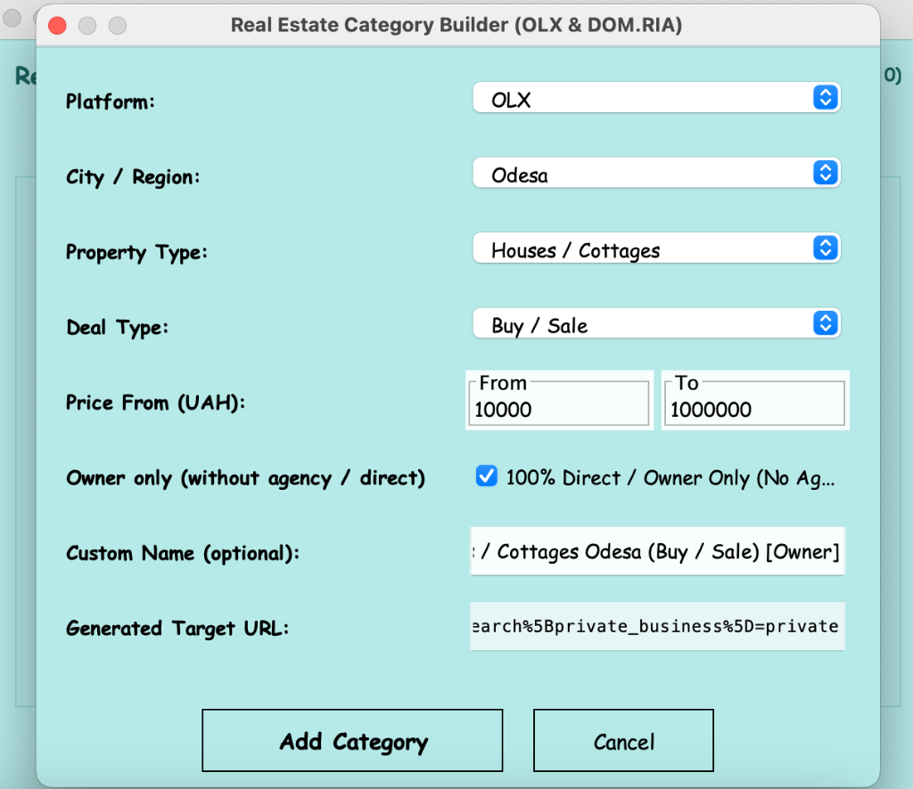
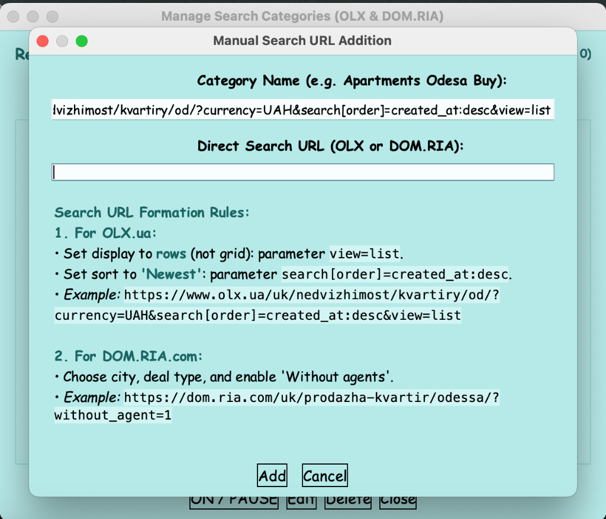
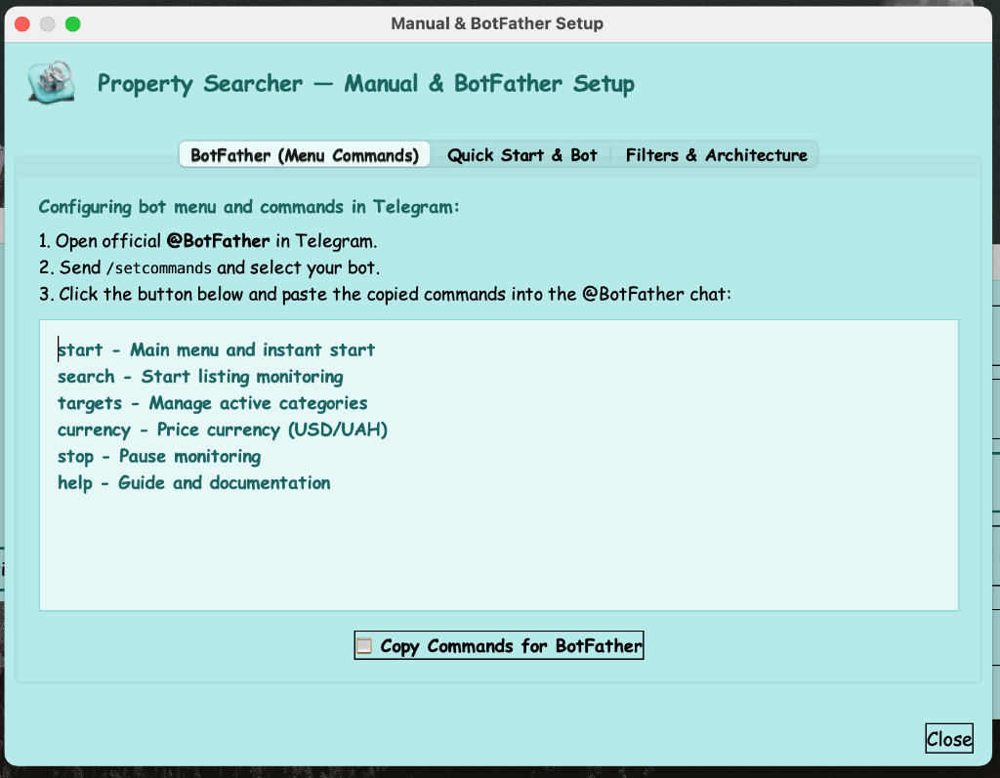
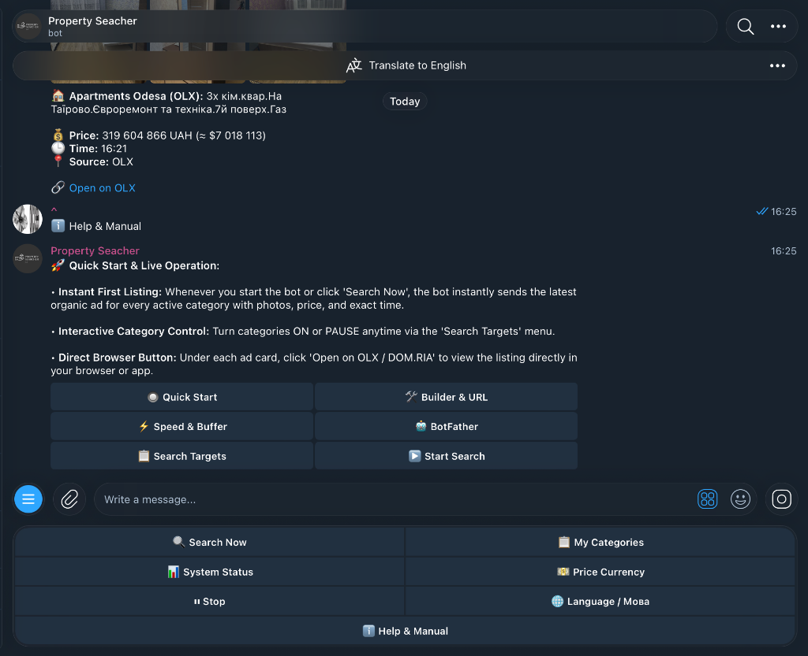
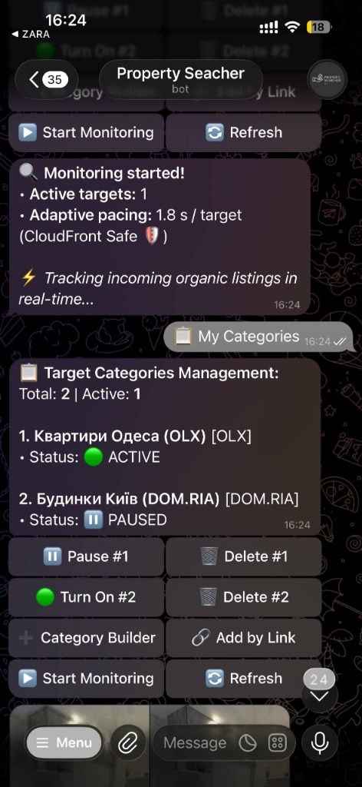
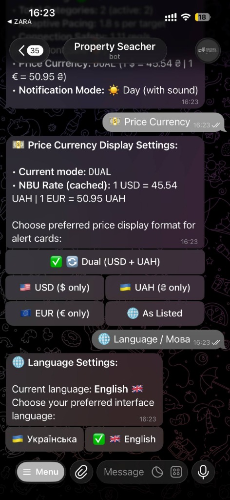
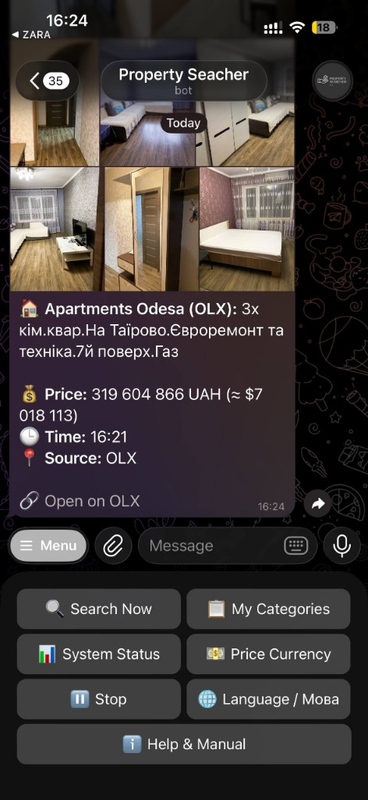

<p align="center">
  
</p>

<h1 align="center">Property Searcher 3</h1>

<p align="center">
  <b>Real-Time Real Estate Monitoring, Currency Valuation & Telegram Alert Platform</b>
</p>

<p align="center">
  <a href="https://openjdk.org/projects/jdk/21/"></a>
  <a href="https://spring.io/projects/spring-boot"></a>
  <a href="https://www.postgresql.org/"></a>
  <a href="https://www.docker.com/"></a>
  <a href="https://github.com/kvolegi/Property-Searcher/actions/workflows/ci.yml"></a>
  <a href="#testing--quality-assurance"></a>
  <a href="ARCHITECTURE.md"></a>
  <a href="LICENSE"></a>
  <a href="https://github.com/kvolegi/Property-Searcher/releases"></a>
</p>

Property Searcher 3 is an automated property valuation and monitoring tool built for the Ukrainian secondary real estate market (OLX.ua and DOM.RIA). It continuously scans listings, detects newly posted properties with ~1.8-second latency, normalizes prices across currencies using official NBU exchange rates, and pushes instant photo galleries to Telegram channels and personal chats.

---

## Architecture Overview

The system is split into two complementary layers:

1. **Standalone Core Client (`core-desktop`)**: A zero-cloud desktop application built on Java 21 and FlatLaf Swing. It features bilingual localization (`uk` / `en`), adaptive token-bucket request throttling, an $O(1)$ circular ring buffer for deduplication, and an autonomous currency conversion engine.
2. **Cloud Microservice Backend (`enterprise-backend`)**: A backend service built with **Spring Boot 3.3.4** and **Java 21 LTS**, with Spring Data JPA, PostgreSQL 16 persistence, Flyway migrations, OpenAPI 3.0 / Swagger documentation, and Actuator metrics.

---

## 📸 Screenshots & Showcase

### 🖥️ Desktop Interface

| Main Dashboard & Control Center | Settings & Configuration Dialog |
| :---: | :---: |
|  |  |
| **Control Center**<br/>One-click scanner control, live status indicators, and language selector. | **Preferences**<br/>Telegram Bot credentials, language preferences, and filter configurations. |

| Smart Category & Filter Builder | Manual URL Rule Addition |
| :---: | :---: |
|  |  |
| **Filter Wizard**<br/>Construct search rules visually for OLX & DOM.RIA by city, rent/sale type, room count, and price limits. | **Direct URL Intake**<br/>Paste portal search URLs straight from your browser with parameter cleanup. |

<p align="center">
  <b>Telegram BotFather Setup Guide</b><br/>
  <br/>
  <i>Built-in step-by-step token setup guide with one-click copy and instant verification.</i>
</p>

### 📱 Telegram Bot & Alerts

| Desktop Command & Help Hub | In-Chat Category Management |
| :---: | :---: |
|  |  |
| **Desktop Telegram Experience**<br/>Multi-tab guide (`/help`), status checking, and persistent keyboard buttons. | **Card-Based Category Controls (`/categories`)**<br/>Target indicators (🟢 ACTIVE / ⏸ PAUSED) with inline buttons `[Pause]`, `[Delete]`, and `[Resume]`. |

| Multi-Currency & Language Preferences | Photo Album Alerts |
| :---: | :---: |
|  |  |
| **Exchange Rate & Language Settings**<br/>NBU rates with customizable display modes (`DUAL`, `USD`, `UAH`, `EUR`, `As Listed`). | **Sub-2s Real-Time Alerts**<br/>Photo group albums with portal deep-links, exact timestamps, and price details. |

---

## Technical Highlights

### 1. Sub-2-Second Edge Detection
Real estate portals deploy CDN layers (Akamai, Cloudflare) and caching tiers. Once a seller posts an ad, it passes moderation and cache invalidation before hitting public edge nodes. Property Searcher polls CDN endpoints with lightweight queries, intercepting listings within **1.8 seconds** of public availability.

### 2. Adaptive Token-Bucket Rate Limiter
To prevent IP blocks and WAF challenges (`HTTP 429 Too Many Requests`), worker threads calculate polling intervals dynamically based on active categories $N$:
$$\tau = \max\left(1800\text{ ms},\; \left\lceil \frac{N \times 1000}{R_{\max}} \right\rceil\right) \quad \text{where } R_{\max} = 2.20\text{ req/s}$$
Thread timings are staggered by $\Delta t = \frac{\tau}{N}$ with a small random jitter ($\pm 150\text{ ms}$) to prevent burst collisions.

### 3. 3-Tier Currency Engine
* **Tier 1 (NBU REST API)**: Direct HTTPS fetch from the National Bank of Ukraine open API (`bank.gov.ua`) with 3000ms timeout.
* **Tier 2 (Local JSON Cache)**: Persists rates in `currency_cache.json` with a 24-hour validity window. Restarts load instantly from cache while a background worker updates rates.
* **Tier 3 (Embedded Fallback)**: Built-in safety rates (USD/UAH, EUR/UAH) keep the app functional during network outages.
* **DUAL Mode**: Converts and displays dual currency strings side-by-side:  
  `$65 000 (≈ 2 704 000 UAH)` / `2 500 000 UAH (≈ $60 096)`.

### 4. 50-Slot Circular Memory Buffer
* **Silent Initialization**: When adding a target, the app indexes the first 30 listings without sending alerts, preventing startup spam.
* **$O(1)$ Circular Buffer**: A 50-item ring buffer tracks recent listing IDs per target. Checks and evictions run in constant time.
* **Sponsored Ad Filtering**: Promoted and banner listings are detected via DOM attributes and skipped before deduplication.

### 5. Asynchronous MediaGroup Dispatch
* **Non-Blocking Pool**: Photo grouping and Telegram Bot API calls run on an asynchronous thread pool (`notificationExecutor`), preventing network latency from holding up scraper threads.
* **Zero-Download Forwarding**: Photos forward directly using remote CDN URLs (`InputMediaPhoto(cdnUrl)`), avoiding local image saving and disk I/O.
* **Night Mode**: Between **23:00 and 07:00** (`Europe/Kyiv`), alerts send with `disable_notification = true` for silent delivery.

### 6. Full Bilingual Support (i18n)
* Complete localization dictionary for **Ukrainian 🇺🇦** and **English 🇬🇧**.
* Auto-detects system locale on first launch with manual toggle in settings and in Telegram (`/language`).

---

## 🚀 How to Run

### Option 1: Universal JAR (Windows, Linux, macOS)

The standalone executable JAR `dist/PropertySeacher-Universal.jar` runs on all major operating systems.

#### Prerequisites
Java 17 or Java 21 LTS (`java -version`).
* **Windows**: Install OpenJDK via winget:
  ```powershell
  winget install EclipseAdoptium.Temurin.21.JRE
  ```
  Or download the installer from [Adoptium](https://adoptium.net).
* **Linux (Ubuntu / Debian / Mint)**:
  ```bash
  sudo apt update && sudo apt install openjdk-21-jre
  ```
* **Linux (Fedora / RHEL)**:
  ```bash
  sudo dnf install java-21-openjdk
  ```
* **Linux (Arch Linux)**:
  ```bash
  sudo pacman -S jre21-openjdk
  ```

#### Launching the Desktop Client
From the project directory:
```bash
java -jar dist/PropertySeacher-Universal.jar
```
* **Windows shortcut**: Double-click `dist/Run_Windows.bat`.
* **Linux shortcut**: Run `bash dist/Run_Linux.sh` or install `dist/PropertySeacher.desktop` into `~/.local/share/applications/`.

---

### Option 2: Pre-Packaged macOS App (`PropertySeacher.app`)

For macOS users, a standalone release is packaged with an embedded Java runtime.

1. Download **`PropertySearcher-macOS.zip`** from [GitHub Releases v3.0.0](https://github.com/kvolegi/Property-Searcher/releases/tag/v3.0.0).
2. Unzip the file to obtain `PropertySeacher.app`.
3. Drag `PropertySeacher.app` to your `/Applications` folder (or run directly).
4. **If macOS Gatekeeper flags the app** (unidentified developer):
   * **Terminal command**:
     ```bash
     xattr -cr /Applications/PropertySeacher.app
     ```
   * **Or via Finder**: Right-click `PropertySeacher.app` $\to$ click **Open** $\to$ click **Open** in the confirmation dialog.
5. The application will start immediately. No separate Java installation is needed.

---

### Option 3: Enterprise Spring Boot Backend & Docker

#### Running via Docker Compose
```bash
docker compose up -d --build
```
This spins up PostgreSQL 16 on port 5432 and the Spring Boot microservice on port 8080.

#### Running Backend Locally from Source
```bash
cd enterprise-backend
mvn spring-boot:run
```

* **Swagger UI API Docs**: `http://localhost:8080/swagger-ui.html`
* **Actuator Health Endpoint**: `http://localhost:8080/actuator/health`

For complete production server setups (systemd daemons, Nginx reverse proxy with SSL), see [DEPLOYMENT.md](DEPLOYMENT.md).

---

## 🛠️ Developer Commands

```bash
# Display available developer commands
make help

# Run the test suite (48 tests across desktop & backend)
make test

# Build both desktop and backend modules
make build

# Launch the desktop client daemon
make run-desktop

# Launch Enterprise Backend & PostgreSQL 16 via Docker Compose
make docker-up
```

---

## 🧪 Testing & Verification

The test suite uses **JUnit 5 Jupiter** and **Mockito** to verify business logic, rate limits, parsing, and resilience:

```bash
# Run desktop tests (40 tests)
cd core-desktop && mvn clean test

# Run backend tests (8 tests)
cd enterprise-backend && mvn clean test

# Or run all tests together
make test
```

### Test Suite Structure (48 Tests, 100% Pass Rate)

| Test Class | Focus | What It Verifies |
| :--- | :--- | :--- |
| **`CategoryCatalogTest`** (9 tests) | URL Generation & Taxonomies | Validates query URL formats across OLX and DOM.RIA, price bounds, owner-only toggles, and city taxonomy integrity. |
| **`CurrencyServiceTest`** (9 tests) | Exchange Rates & Formatting | Verifies NBU live/fallback rate calculations (USD/EUR $\leftrightarrow$ UAH), regex price parsing across multiple notations, and dual-currency text output. |
| **`DeduplicationAndSnipingTest`** (6 tests) | Rate Limiting & Deduplication | Confirms `calculateAdaptiveDelay()` keeps overall request frequency below $2.3\text{ req/s}$ for any target count $N \in [1, 50]$; verifies $O(1)$ ring buffer eviction and duplicate discarding. |
| **`I18nTest`** (13 tests) | Bilingual Localization | Checks 100% key parity between Ukrainian (`uk`) and English (`en`) dictionaries (no missing keys), thread-safe runtime switches, and locale fallbacks. |
| **`SettingsManagerTest`** (3 tests) | Config Persistence | Uses `@TempDir` sandboxes to test round-trip file serialization, active/paused target states (`#OFF#`), and backwards compatibility. |
| **`PropertyControllerTest`** (5 tests) | REST API & MockMvc | Tests Spring Boot 3 WebMvc endpoints: paginated listings (`200 OK`), target creation (`201 Created`), RFC 7807 global error handling (`400 Bad Request`), and metrics endpoints. |
| **`TrackingServiceTest`** (3 tests) | Event Dispatch & Analytics | Tests Spring Boot 3 service layer with Mockito: event publishing, price change tracking, and deal score calculations. |

---

## ⚖️ License & Terms

Personal portfolio project. Provided for evaluation, code review, and educational demonstration.

Copyright (c) 2021–2026 **kvolegi**. All Rights Reserved.  
For full terms, see [LICENSE](LICENSE).
