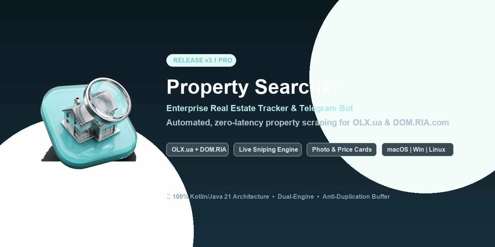

# Property Searcher 3 🏢⚡

<p align="center">
  
</p>

<p align="center">
  <a href="https://openjdk.org/projects/jdk/21/"></a>
  <a href="https://spring.io/projects/spring-boot"></a>
  <a href="https://core.telegram.org/bots"></a>
  
  
  
  <a href="LICENSE"></a>
</p>

---

## 📌 Executive Overview (Огляд платформи)

**Property Searcher 3** — це високопродуктивна відмовостійка платформа реального часу для безперервного моніторингу вторинного ринку нерухомості з суб-2-секундною детекцією нових лістингів та автоматичною доставкою структурованих медіа-альбомів у Telegram.

Платформа поєднує два архітектурні компоненти:
1. **Desktop Client Engine (Core 3):** легкий нативний клієнт (macOS `.app`, Windows `.bat`, Linux `.desktop`) із нульовою залежністю від зовнішніх серверів, підтримкою локалізації (Українська / English), адаптивним балансером безпеки та пам'яттю $O(1)$.
2. **Enterprise Cloud Backend:** розподілений мікросервіс на базі **Spring Boot 3 (Java 21 LTS)** з реляційним збереженням історії котирувань, ціновою аналітикою та інтерактивним OpenAPI/Swagger інтерфейсом.

---

## 🌟 Ключові можливості (Core Architecture Highlights)

* **📸 Нативні медіа-альбоми Telegram (SendMediaGroup):**  
  Автоматичне вилучення повної галереї об'єкта (до 10 фотографій у високій роздільній здатності) та відправка єдиним пакетом із лаконічною стандартизованою шапкою.
* **🌐 Повна двомовність (i18n: Українська / English):**  
  При первинному запуску система пропонує вибір мови інтерфейсу. Перемикання доступне будь-коли в меню налаштувань десктопу та через команду `/language` у Telegram.
* **⚡ Адаптивний балансер швидкості (Adaptive Token-Bucket Rate Controller):**  
  Динамічний розрахунок затримки для кожного пошукового потоку під безпечний поріг $\le 2.20\text{ req/s}$, що виключає блокування IP за правилами CloudFront / DataDome.
* **💱 Трьохрівневий валютний шлюз (Resilient 3-Tier Currency Engine):**  
  Автоматична конвертація за офіційним курсом НБУ (`bank.gov.ua`) у подвійному форматі `DUAL` (наприклад, `$65 000 (≈ 2 704 000 грн)`). Локальний файл-кеш (TTL 24h) гарантує стабільний запуск за 0 мс навіть при нерегулярній роботі машини.
* **🛡️ 50-Slot Circular Buffer & Silent Baseline:**  
  Безшумна 30-елементна індексація стартової сторінки виключає спам старими оголошеннями при запуску. Кільцевий буфер на 50 слотів запобігає дублікатам при перестановках оголошень на порталі.
* **🌙 Нічний тихий режим (Night Silent Mode):**  
  Автоматичне вимкнення звукового сигналу (`disable_notification = true`) у період з 23:00 до 07:00 за київським часом.
* **🎨 Преміальна айдентика:**  
  Фірмова палітра `#B6EAE9` / `#64CFCB`, тривимірний скляний логотип та нативні іконки macOS (`.icns`), Windows (`.ico`) та Linux (`.png`).

---

## 📁 Структура папки репозиторію

```text
Property Searcher 3/
├── social_preview.png              # Соціальне прев'ю платформи
├── README.md                       # Головна презентація для GitHub
├── DEPLOYMENT.md                   # Керівництво з розгортання на Linux / Docker / Systemd
├── TECHNICAL_SPECIFICATION.md      # Повна інженерна технічна специфікація
├── ARCHITECTURE.md                 # C4 діаграми, пайплайни та шаблони
├── LICENSE                         # Ліцензія MIT (Автор: kvolegi)
├── CONTRIBUTING.md                 # Стандарти та гайдлайни розробки
├── core-desktop/                   # Вихідний код нативного клієнта (Java 21, i18n, GUI)
│   ├── pom.xml
│   └── src/
├── enterprise-backend/             # Вихідний код Spring Boot 3 бекенду (Java 21 LTS)
│   ├── pom.xml
│   ├── Dockerfile
│   ├── docker-compose.yml
│   └── src/
└── dist/                           # Готові скомпільовані релізи
    ├── PropertySeacher.app         # Нативний macOS додаток
    ├── PropertySeacher-Universal.jar # Універсальний JAR-архів (Java 17+)
    ├── Run_Windows.bat             # Лаунчер для Windows
    ├── Run_Linux.sh                # Лаунчер для Linux
    ├── settings.txt                # Файл налаштувань
    └── assets/                     # Іконсет-пакети (.icns, .ico, .png)
```

---

## 🚀 Швидкий запуск (Quick Start)

### 1. Запуск десктопного додатку
* **macOS:** Відкрийте [`dist/PropertySeacher.app`](dist/PropertySeacher.app) або виконайте в терміналі:
  ```bash
  open "dist/PropertySeacher.app"
  ```
* **Windows:** Запустіть [`dist/Run_Windows.bat`](dist/Run_Windows.bat).
* **Linux:** Зробіть скрипт виконуваним та запустіть:
  ```bash
  chmod +x dist/Run_Linux.sh && ./dist/Run_Linux.sh
  ```
* **Універсальний запуск JAR:**
  ```bash
  java -jar dist/PropertySeacher-Universal.jar
  ```

### 2. Запуск корпоративного сервера (Spring Boot 3)
```bash
cd enterprise-backend
mvn spring-boot:run
```
* **Swagger / OpenAPI Documentation:** `http://localhost:8080/swagger-ui.html`
* **Health & Actuator:** `http://localhost:8080/actuator/health`

Або через Docker Compose:
```bash
docker compose up -d
```

> [!TIP]
> Детальну інструкцію з налаштування Linux VPS, Docker, systemd, Nginx SSL, ротації логів та бекапів БД дивіться у файлі [DEPLOYMENT.md](DEPLOYMENT.md).

---

## ⏱️ Фізика швидкості та специфіка CDN-інфраструктури

> [!NOTE]
> Сучасні портали використовують глобальні CDN-мережі (Akamai/Cloudflare). Створене автором оголошення спочатку спрямовується у чергу модерації та антиспам-валідації сайту, потрапляючи у публічний доступ через **30–90 секунд**.  
> **Property Searcher перехоплює об'єкт у перші ж 1–2 секунди** після його фактичної появи у публічному інтернет-просторі та миттєво відправляє фотоальбом у Telegram. Швидше перехопити публікацію технічно неможливо, оскільки до проходження CDN-модерації об'єкта ще фізично немає у веб-мережі.

---

## 👨‍💻 Одноосібний автор
* **kvolegi** — архітектура, розробка десктопного клієнта, снайпінг-ядра та Spring Boot 3 бекенду.

## ⚖️ Ліцензія
Проєкт ліцензовано на умовах **MIT License** (Copyright (c) 2021–2024 **kvolegi**). Подробиці див. у [LICENSE](LICENSE).
